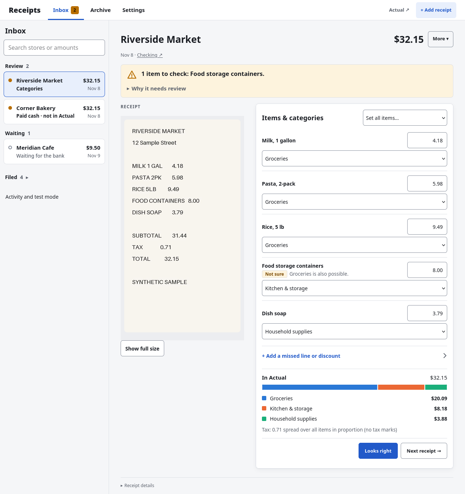
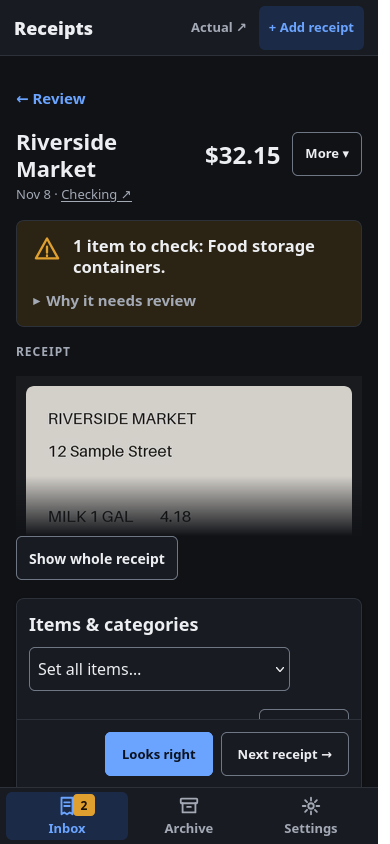
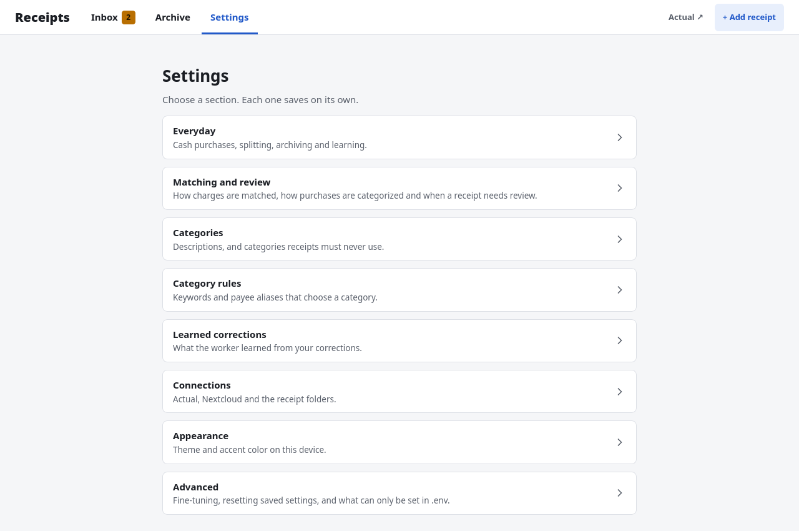
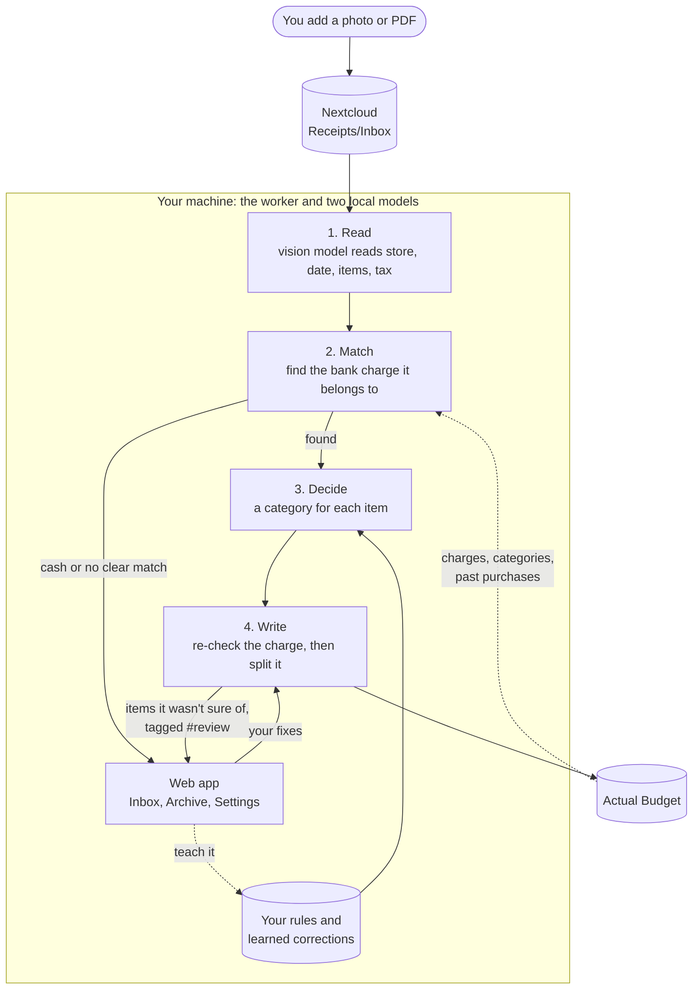

# Actual-Budget-Receipt-Processor

Processes receipt photos uploaded to Nextcloud with a local vision model (llama.cpp), sorts each item into your Actual Budget categories with a local decision model, and splits the matching transaction in Actual when it is confident. Anything it is unsure about goes to a review folder.

## Actual Budget Receipt Processor

Take a photo of a receipt and upload it. A few minutes later the matching bank charge in
[Actual Budget](https://actualbudget.org) (a free budgeting app you run yourself) is filed under the right budget
categories, item by item. If the receipt covers several categories (groceries and cleaning supplies, say), the charge
is split into one part per category.

**By default everything runs on your own computer.** Your receipt photos and purchases are sent nowhere except to your
own Actual and Nextcloud servers. Two optional cloud features are off unless you switch them on: see
[Privacy](#privacy).



<table>
<tr>
<td width="30%" valign="top"></td>
<td valign="top"></td>
</tr>
<tr>
<td valign="top">On a phone, with dark mode</td>
<td valign="top">Settings: categories, rules and what it learned from you, all in the web app</td>
</tr>
</table>

All screenshots use made-up receipts.

**On this page:**
[How it works](#how-it-works) ·
[Install](#install) ·
[Everyday use](#everyday-use) ·
[Teaching it your household](#teaching-it-your-household) ·
[Commands](#commands) ·
[Settings](#settings) ·
[Privacy](#privacy) ·
[Troubleshooting](#troubleshooting)

## How it works



It never creates bank transactions on its own: your bank sync puts the charge in Actual, and the pipeline only files it.
It starts in **dry run** (shows what it would do, changes nothing) until you switch it to **live**.

One short page per step: [How it works](docs/how-it-works.md).

## Install

You need:

- a Linux computer with [Docker](https://docs.docker.com/engine/install/);
- a graphics card (AMD, Intel or NVIDIA) with about 9 GB free (setup picks smaller settings for 8 GB; with no card it
  runs on the processor, just slowly) and about 10 GB of disk for the two models;
- an Actual Budget server with your bank transactions in it, and a [Nextcloud](https://nextcloud.com) server to upload
  receipts to.

```
git clone https://github.com/dakotagrvtt/Actual-Budget-Receipt-Processor.git receipt-pipeline
cd receipt-pipeline
./receipts setup
```

Setup checks Docker, asks for your Actual and Nextcloud details, picks settings for your graphics card, downloads the
models, offers to create `Receipts/Inbox`, tests the connections and drafts a description for each budget category. It asks
before anything big, and you can run it again any time. At the end it prints the link to your **receipt app**.

**Your first receipt:** upload one for a purchase already in Actual, open the app, go to **Activity and test mode** (at
the bottom of the Inbox list) and press **Check now**. When the results look right, press **Go live**.

## Everyday use

Upload receipts to `Receipts/Inbox` (the Nextcloud phone app can do it automatically) or with **+ Add receipt** in the
app. The pipeline checks every 5 minutes, and the models unload after 5 idle minutes to free the graphics card.

The **receipt app** is the control panel. Its link holds a secret key (`./receipts trigger-url` prints it again), so keep
it private and on your own network. It has three tabs:

- **Inbox**: receipts grouped into **Review**, **Waiting** and **Filed**. Fix an item's category or amount, pick a
  different charge with **Find a charge**, or create a cash purchase. **Undo** works for 15 minutes.
- **Archive**: receipts you are done with, searchable, with **Restore**.
- **Settings**: categories, keywords, what it learned, matching, connections and appearance. Changes apply at the next
  check, without a restart.

Anything it isn't sure of waits in **Review** with the reason, and charges it changed but wants you to check are tagged
`#review` in Actual.

More: [The web app](docs/web-app.md) and [Reviewing and fixing a receipt](docs/review.md).

## Teaching it your household

- **Category descriptions:** a sentence per category ("the kids' clothes, toys and diapers"). Setup drafts them; edit
  them under **Settings › Categories**.
- **Keywords:** for what a description can't say. Add them in Settings, or type `#always Pampers` (a rule) or
  `#usually Pampers` (a strong hint) in the note of a split part in Actual.
- **Your fixes:** when you change a category it filed, it notices and remembers, and after a couple of the same fix it
  adds a keyword. See and **Forget** them under **Learned corrections**.

More: [Keywords](docs/categories.md#keywords) and [Learning from your corrections](docs/learning.md).

## Commands

Day to day you don't need these. `./receipts help` lists them all.

| Command | What it does |
|---|---|
| `./receipts setup` | First-time setup; run again to fill in anything missing |
| `./receipts start` / `stop` / `restart` | Start, stop (frees the graphics card), or restart after editing `.env` |
| `./receipts update` | Rebuild after a code update |
| `./receipts status` / `logs` | Mode, health and any alert / follow the log |
| `./receipts check` | Test every connection (changes nothing) |
| `./receipts mode dry` / `mode live` | Switch mode, like the app's switch |
| `./receipts trigger-url` | Print the app link again |
| `./receipts download-models` | Fetch the models (also after changing a model setting) |
| `./receipts exclude` | Pick category groups receipts never go to, such as bills and savings |
| `./receipts keyword …` | Add, remove, list and test keywords |
| `./receipts replay …` | Re-run filed receipts and compare, changing nothing |

## Settings

Every setting is in `.env`; [`.env.example`](.env.example) lists them all with their tested defaults. Many can also be
changed on the app's **Settings** pages, which win over `.env`. After editing `.env`, run `./receipts restart`. The ones
you are most likely to want:

| Setting | What it does |
|---|---|
| `MATCH_TOLERANCE_PERCENT=25` | Allows restaurant tips (charge higher than the receipt) |
| `MATCH_ACCOUNTS` | Only look for charges in these Actual accounts |
| `EXCLUDE_CATEGORY_GROUPS` | Category groups receipts never go to (`./receipts exclude` sets it) |
| `DECIDER_MODEL` / `READER_LOCAL_MODEL` | Swap a model ([reader](docs/reading.md#the-local-reader-model)); then `./receipts download-models` |
| `LEARNING=off` | Stop learning from your corrections |
| `MODEL_SLEEP_SECONDS=-1` | Keep the models loaded (if another app shares the graphics card) |

To try a value on your own receipts first, run `./receipts replay`. How each default was chosen:
[Research](docs/research.md).

## Privacy

**Default: everything is local.** The photo, the reading, the categorizing and what you taught it stay in `data/` on
your computer. The only outside connections are your own Actual and Nextcloud servers and the one-time model downloads.

Two optional cloud features, each off unless you choose it in setup or `.env`:

| | What leaves your machine | Goes to | Keep it local with |
|---|---|---|---|
| Cloud reader | The whole receipt photo (location data removed) | OpenAI or OpenRouter, with your key | `READER_PROVIDER=local` (default) |
| Hosted decider | Anonymized item text (names and places hidden, categories as codes), never the photo | TypeSafe | `DECIDER_PROVIDER=local` (default) |

A cloud reader sees everything on the receipt, including card digits and loyalty numbers. For the hosted decider, run
`./receipts replay --preview-remote <folder>` to see exactly what would be sent before you switch. Full details:
[Cloud options](docs/cloud.md).

## Troubleshooting

- **Something isn't working:** `./receipts check` tests every connection and says what's wrong. `./receipts status`
  shows a **WORKER ALERT** when a setup problem has paused the checks; fix it and run `./receipts restart`.
- **Out of graphics memory:** put `DECIDER_GPU_LAYERS=0` in `.env` (moves the decider to the processor) and restart.
  See [Running it](docs/running.md).
- **A receipt went to review:** its page says why. Fix the cause and press **Try again**, or fix the items and **Save
  changes**.
- **The store name never matches the bank's:** list the spellings in `data/payee-aliases.json` (copy
  `payee-aliases.example.json`). See [Matching tips](docs/matching.md#tips).
- **The app says "forbidden":** the link needs its key. Run `./receipts trigger-url`.

## License

[AGPL-3.0](LICENSE)
