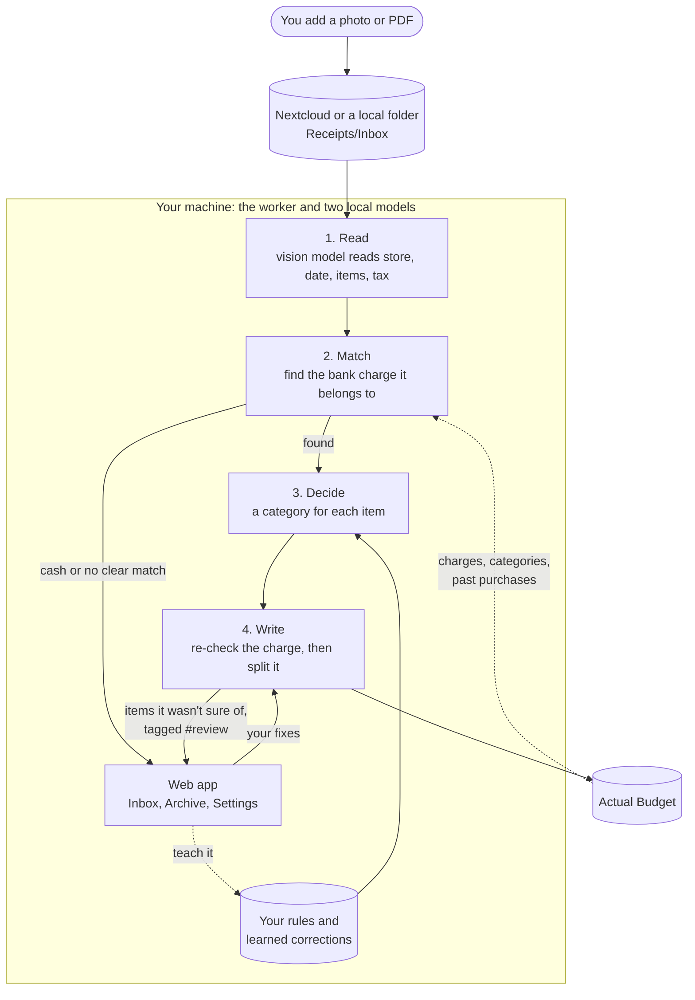

# How it works

You add a receipt photo. The worker reads it, finds the bank charge it belongs to in Actual Budget, and splits that charge
by category. Anything it isn't sure of waits for you in the web app.

| Step | What happens | Details |
|---|---|---|
| **1. Read** | A local vision model reads the store, date, items and tax from the photo. | [Reading a receipt](reading.md) |
| **2. Match** | It finds the one bank charge with the same amount, date and store. If the charge isn't in Actual yet, it checks again every hour. | [Finding the bank charge](matching.md) |
| **3. Decide** | A second local model picks a category for each item, using your rules, keywords and past purchases. | [Picking categories](categories.md) |
| **4. Write** | The charge is split by category, with tax and tip spread across the parts. It re-checks the charge right before writing. | [Splitting and writing to Actual](splitting.md) |
| **Review** | Unsure items, cash, returns and charges it can't match wait in the **Inbox** for you to check or fix. | [Reviewing and fixing a receipt](review.md) |

**More:** [The web app](web-app.md) · [Learning from your corrections](learning.md) · [Running it](running.md) (GPU,
outages, offline) · [Replay tests](testing.md) · [Cloud options](cloud.md) · [Research](research.md)

**What leaves the machine.** Nothing but requests to your own Actual and Nextcloud servers (none to Nextcloud with a local folder; plus a one-time Actual API download after an Actual upgrade; no receipt data), unless you turn on one of the
two optional [cloud options](cloud.md): the cloud reader sends the receipt photo, and the hosted decider sends anonymized
item text.

**Dry run and live.** In dry run nothing is written to Actual; you see what would happen. Switch in the web app.

**Settings.** Many can be changed under **Settings** in the web app. All of them, with defaults, are in
[`.env.example`](../.env.example); run `./receipts restart` after editing `.env`.

**Words used here.** The *reader* turns a photo into data. The *decider* picks a category for each item. The *worker* does
everything else. A *transaction* is a bank charge in Actual.
